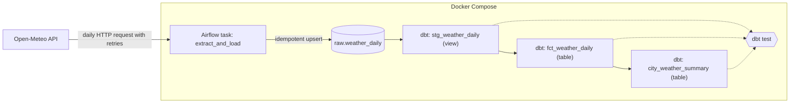
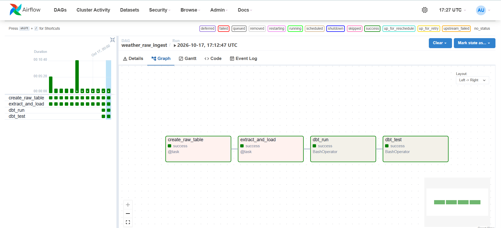
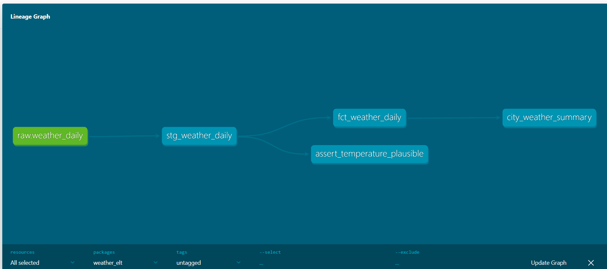
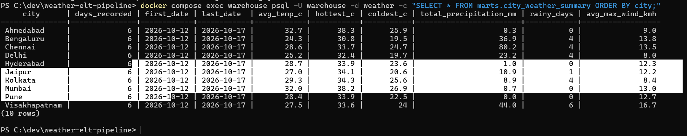

# Weather ELT Pipeline: Airflow, dbt and Postgres

An automated daily ELT pipeline that loads weather data for 10 Indian cities from a public API into a Postgres warehouse, transforms it with dbt, and tests it on every run. Everything runs locally in Docker, at no cost.

**Stack:** Apache Airflow 2.10 · dbt Core 1.9 (dbt-postgres) · PostgreSQL 16 · Docker Compose · Python

## Architecture



Each daily Airflow run executes four tasks in order:

`create_raw_table` → `extract_and_load` → `dbt_run` → `dbt_test`



## Data

Source: [Open-Meteo](https://open-meteo.com) (free, no API key). For each of 10 cities (Bengaluru, Mumbai, Delhi, Chennai, Kolkata, Hyderabad, Pune, Ahmedabad, Jaipur, Visakhapatnam) the pipeline loads daily maximum, minimum and mean temperature, precipitation, maximum wind speed and the weather code.

## Data model

| Layer | Object | Type | Purpose |
|---|---|---|---|
| raw | `raw.weather_daily` | table | Data exactly as loaded by Airflow, one row per city per day |
| staging | `stg_weather_daily` | view | Adds a unique key and a readable weather description |
| marts | `fct_weather_daily` | table | Daily facts with temperature range and a rainy-day flag |
| marts | `city_weather_summary` | table | One row per city: averages, extremes, rainy days, wind |



## Data quality

dbt tests run after every load:

- `not_null` and `unique` tests on keys and key columns in staging and marts
- `not_null` tests on the raw source columns
- A custom test that fails if a mean temperature is outside -10 to 55 °C or if the daily maximum is below the minimum

If a test fails, the `dbt_test` task turns red in Airflow.

## Design decisions

- **Idempotent loads:** the raw table has a primary key on (city, date) and uses `INSERT ... ON CONFLICT DO UPDATE`, so re-running or back-filling a day never creates duplicates.
- **Two layers of retries:** the HTTP session retries temporary API errors (429 and 5xx) with a growing wait, and Airflow retries failed tasks twice.
- **Backfill support:** the DAG uses Airflow's logical date and `catchup=True`, so missed days are loaded automatically.
- **dbt isolated in its own virtual environment** inside the Airflow image, so its dependencies cannot clash with Airflow's.
- **No secrets in the repo:** credentials live in a git-ignored `.env`, are passed to containers as environment variables, and are read by dbt through `env_var()`. Airflow gets the warehouse connection through an environment variable too.
- **Separate databases:** Airflow's metadata database and the analytics warehouse are different Postgres containers.
- **Port 5433** for the warehouse avoids clashing with a local PostgreSQL on 5432.

## Results



## How to run it

**Prerequisites:** Docker Desktop (with WSL2 on Windows) and Git. About 8 GB of free RAM is recommended.

```
git clone https://github.com/Ramesh-Dasari-6875/weather-elt-pipeline.git
cd weather-elt-pipeline

copy .env.example .env      # then edit .env and set your own passwords (letters and numbers only)

docker compose build
docker compose up airflow-init
docker compose up -d
```

1. Open `http://localhost:8080` and log in as `admin` with the `AIRFLOW_ADMIN_PASSWORD` from your `.env`.
2. Turn on the `weather_raw_ingest` DAG, or click Trigger to run it once.
3. Query the warehouse (port 5433, database `weather`):

```
docker compose exec warehouse psql -U warehouse -d weather -c "SELECT * FROM marts.city_weather_summary;"
```

Run dbt by hand:

```
docker compose exec -w /opt/airflow/dbt airflow-scheduler /home/airflow/dbt_venv/bin/dbt build
```

Stop everything with `docker compose down` (add `-v` to also delete the stored data).

**Note on the start date:** the Open-Meteo forecast endpoint only serves roughly the last 90 days. Set `start_date` in `dags/weather_ingest.py` to a date within that window before running a backfill.

## Project structure

```
weather-elt-pipeline/
├── docker-compose.yml        # Airflow, warehouse Postgres, Airflow metadata DB
├── Dockerfile                # Airflow image with dbt in its own virtual environment
├── .env.example              # template for credentials (copy to .env)
├── dags/
│   └── weather_ingest.py     # the Airflow DAG
├── warehouse/
│   └── init.sql              # creates the raw, staging and marts schemas
├── dbt/
│   ├── dbt_project.yml
│   ├── profiles.yml          # credentials from environment variables
│   ├── macros/               # schema naming
│   ├── models/
│   │   ├── staging/
│   │   └── marts/
│   └── tests/                # custom data test
└── docs/                     # screenshots
```

## Possible next steps

- Add a dashboard (Power BI or Metabase) on `marts.city_weather_summary`
- Switch the facts model to an incremental dbt model as data grows
- Add failure alerts (email or Slack) from Airflow
- Add more cities and variables, and source freshness checks

## Author

**Ramesh Dasari** · [GitHub](https://github.com/Ramesh-Dasari-6875)
